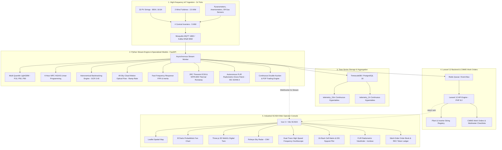

# GridFlow: Smart Grid & Renewable Energy Yield Forecaster
### Industrial-Grade IoT Telemetry, Multi-Quantile ML, Digital Twin & VPP Microgrid Platform

[](https://python.org)
[](https://fastapi.tiangolo.com)
[](https://lightgbm.readthedocs.io)
[](https://laravel.com)
[](https://vuejs.org)
[](https://threejs.org)
[](https://timescale.com)

---

## ⚡ The Business Problem & Mission

Large-scale renewable power plants and microgrids face severe financial penalties and operational risks:
1. **Contractual Schedule Imbalances**: CAISO, ERCOT, and European TSOs penalize deviations from day-ahead committed schedules. Operators require high-frequency inverter string monitoring and rolling forecast models to dynamically dispatch Battery Energy Storage Systems (BESS) to cover generation deficits before penalties accrue.
2. **Ramp-Rate Violations**: Severe ramp-down events ($R < -2.0\,\text{MW/min}$) caused by passing cloud fronts destabilize the grid and trigger regulatory fines.
3. **Asset Degradation & Safety**: Battery cells degrade under aggressive cycling, and thermal runaway poses catastrophic safety hazards under NFPA 855 / UL 9540A standards.
4. **Transmission Congestion**: Feeder line bottlenecks require real-time Locational Marginal Pricing (LMP) and local Peer-to-Peer (P2P) trading across Virtual Power Plants (VPPs) to balance supply and demand locally.

**GridFlow** is an end-to-end industrial SCADA, predictive machine learning, and autonomous control platform engineered for **Solaria West (Mojave High-Desert Microgrid: 20 MW Solar PV, 5 MW Wind, 10 MWh BESS)** and its regional Virtual Power Plant partners.

---

## 🏗️ Architecture & Core Tech Stack



---

## 🔬 The 10 Advanced Engineering Modules

### 1. Probabilistic Quantile Forecasting ($P_{10}, P_{50}, P_{90}$)
- **Engine**: Multi-quantile LightGBM regression models trained on solar irradiance, ambient temperature, module thermal inertia, and wind speed.
- **Renewable Market Semantics**: 
  - $P_{90}$ is the conservative safe floor exceeded 90% of the time (used for penalty-free grid bidding).
  - $P_{50}$ represents the median expected generation.
  - $P_{10}$ represents high-yield upside potential.
- **Monotonicity**: Strict quantile monotonicity ($P_{10} \ge P_{50} \ge P_{90}$) is mathematically enforced.

### 2. Historical Time-Machine & Incident Playback Engine
- **Engine**: Scrubber controller with variable playback speeds (1x, 2x, 4x) and frame-by-frame stepping.
- **Incident Scenarios**:
  - `INC-2026-041`: Severe passing cumulus cloud front causing sudden -70% solar irradiance drop.
  - `INC-2026-088`: Combiner box blown fuse on `INV-02:STR-03` with immediate voltage collapse to 0.0V.
  - `INC-2026-112`: 1,200 MW regional generator trip causing grid frequency plunge to 59.68 Hz.

### 3. Automated Field Technician Work Orders (CMMS)
- **Engine**: Built directly into **Laravel 12** on PHP 8.2 with SQLite/PostgreSQL persistence.
- **Workflow**:
  - Automatically triggered when inverter string voltage divergence exceeds 12% ($\Delta V > 12\%$).
  - Generates specialized multimeter checklists (e.g. open-circuit voltage $V_{oc}$, string short-circuit current $I_{sc}$, insulation resistance $R_{iso}$, and torque verification).
  - Dispatches automated notifications via `DispatchWorkOrderNotificationJob`.

### 4. Model Predictive Control (MPC) 4-Hour Battery Dispatch
- **Engine**: Multi-period linear programming solved via `scipy.optimize.linprog(method="highs")`.
- **Horizon**: 4-hour forward lookahead ($T = 16$ time steps, $\Delta t = 15\,\text{min}$).
- **Objective Function**: Maximizes energy arbitrage revenue and avoided PPA shortfall penalties while penalizing lithium-ion cell degradation ($C_{\text{deg}} \approx \$0.022/\text{kWh}$).

### 5. 3D Digital Twin & Astronomical Solar Tracker
- **Engine**: Full Three.js / WebGL hardware-accelerated 3D scene.
- **Astronomical Positioning**: Calculates solar elevation, azimuth, and zenith angles for the plant's exact coordinates ($35.0110^\circ\text{N}, 115.4734^\circ\text{W}$).
- **Mathematical Backtracking**: Prevents row-to-row morning/evening direct beam shading at a ground cover ratio ($GCR = 0.40$):
  $$\theta_{\text{backtrack}} = \arcsin\left(\frac{\sin \theta_{\text{true}}}{GCR}\right)$$
- **Features**: 32 motorized PV tracker tables, 2 animated wind turbines, 4 BESS Megapacks, 230kV substation, raycasting HUD, and PBR/Thermal IR/Fault visual modes.

### 6. All-Sky Cloud Motion Vector (CMV) & Ramp-Rate Engine
- **Engine**: Polar fisheye sky camera simulation with Lucas-Kanade optical flow.
- **Ground Shadow Footprint**: Projects approaching cloud shadows onto the 250m plant layout to compute Time-to-Impact (TTI).
- **Ramp Smoothing**: Pre-activates BESS fast-ramp buffer injection when predicted ramp rate $R < -2.0\,\text{MW/min}$, keeping net injection well within regulatory limits ($<0.5\,\text{MW/min}$).

### 7. Fast Frequency Response (FFR) & Synthetic Inertia
- **Engine**: Dynamic grid frequency simulation adhering to CAISO/ERCOT ancillary service standards:
  - **Synthetic Inertia**: $P_{\text{inertia}} = -2H \frac{df}{dt}$ ($H = 4.5\,\text{s}$).
  - **Primary Frequency Response (Droop)**: $s = 4.0\%$ with $\pm 0.036\,\text{Hz}$ deadband.
  - **Fast Frequency Response (FFR)**: Instantaneous sub-second $+5.0\,\text{MW}$ injection when frequency drops below $59.70\,\text{Hz}$.
- **SCADA UI**: High-speed dual-trace oscilloscope tracking grid frequency and BESS fast response.

### 8. BESS Health (SOH) & NFPA 855 Thermal Runaway Early Warning
- **Engine**: 2RC Thevenin Equivalent Circuit Model (ECM) simulating terminal voltage, ohmic resistance ($R_0$), and polarization RC branches ($R_1 C_1, R_2 C_2$).
- **Safety**: 4-Stage Thermal Runaway Early Warning complying with NFPA 855 & UL 9540A:
  - Stage 1: Thermal Overstress ($T > 45^\circ\text{C}$).
  - Stage 2: Micro-Short & Rapid Voltage Sag.
  - Stage 3: Off-Gas Detection ($H_2 > 20\,\text{ppm}, CO > 15\,\text{ppm}$).
  - Stage 4: Thermal Propagation & Automated DC Contactor Trip.
- **SCADA UI**: 16-rack cell matrix heatmap and Electrochemical Impedance Spectroscopy (EIS) Nyquist plot.

### 9. Autonomous Drone Thermography & Aerial IR Defect Classification
- **Engine**: Autonomous quadcopter patrol following a 16-waypoint lawnmower flight grid at 35m AGL.
- **IEC 62446-3 Classification**:
  - Class 1: Minor anomaly ($\Delta T < 10^\circ\text{C}$).
  - Class 2: Moderate hot spot ($10^\circ\text{C} \le \Delta T \le 30^\circ\text{C}$).
  - Class 3: Critical fire hazard ($\Delta T > 30^\circ\text{C}$).
- **SCADA UI**: Radiometric FLIR thermal viewfinder with Ironbow false-color palette, crosshair spot temperature meter, and inspection report generator.

### 10. Virtual Power Plant (VPP) Aggregation & P2P Microgrid Trading
- **Aggregated Fleet**:
  - **Solaria West** (25 MW Solar/Wind/BESS Anchor Prosumer).
  - **Mojave Green Hydrogen Electrolyzer** (8.0 MW PEM flexible load with 12h $H_2$ buffer).
  - **Boron Lithium Processing Facility** (6.5 MW baseload industrial load with transmission congestion on Feeder 3).
  - **Mojave Compute AI Center** (4.0 MW IT load with 1.5 MW curtailable batch training workloads).
- **Market Mechanism**:
  - Continuous Double-Auction & Merit-Order Clearing.
  - Locational Marginal Pricing (LMP): $\text{LMP}_i = \text{MCP} + \text{Congestion}_i + \text{Losses}_i$.
  - Cryptographic Renewable Energy Certificates (REC tokens) with SHA-256 origin proofs and $0.385\,\text{tCO}_2/\text{MWh}$ avoided emissions tracking.
- **SCADA UI**: Visual market depth step chart, real-time bilateral transaction ledger, and demand-response drills.

---

## 🚀 Quickstart & Execution

### Option 1: One-Click Windows Master Launcher (Recommended)
Simply double-click:
```bat
start_all.bat
```
This launches all 3 subsystems in dedicated, titled console windows and automatically opens the SCADA interface in your default browser:
1. **Python Stream & ML Inference Engine** (`http://127.0.0.1:8000`)
2. **Laravel 12 Backend** (`http://127.0.0.1:8080`)
3. **Vue 3 SCADA Dashboard** (`http://localhost:5173`)

---

### Option 2: Individual Batch Launchers
- **Stream Engine**: `start_stream_engine.bat`
- **Laravel Backend**: `start_backend.bat`
- **SCADA Frontend**: `start_frontend.bat`
- **Run All Tests**: `run_tests.bat`
- **Build Frontend**: `build_frontend.bat`

---

### Option 3: Manual Command-Line Execution

#### 1. Python Stream & ML Engine
```powershell
python -m uvicorn stream_engine.api:app --host 127.0.0.1 --port 8000 --reload
```

#### 2. Laravel 12 Backend
```powershell
cd backend
php artisan serve --port 8080
```

#### 3. Vue 3 SCADA Frontend
```powershell
cd frontend
npm.cmd run dev
```

---

## 🧪 Automated Testing & Verification

Run the full automated test suite covering all 10 engineering modules:
```powershell
python -m unittest discover stream_engine/tests -v
```
*(Or double-click `run_tests.bat`)*

**Test Suite Coverage (34 Unit Tests)**:
- `test_stream.py`: Multi-quantile LightGBM ($P_{10}/P_{50}/P_{90}$), anomaly detector, BESS dispatch.
- `test_mpc.py`: HiGHS linear programming 4-hour forward lookahead and degradation accounting.
- `test_solar_tracker.py`: Astronomical elevation/azimuth and mathematical backtracking ($GCR = 0.40$).
- `test_cloud_motion.py`: Optical flow cloud motion vectors, TTI countdown, and ramp rate smoothing.
- `test_frequency_droop.py`: Synthetic inertia ($H = 4.5\,\text{s}$), primary droop ($s = 4.0\%$), and FFR injection.
- `test_battery_health.py`: 2RC Thevenin ECM, SOH, off-gas sensor thresholds, and automated DC contactor trip.
- `test_drone_inspection.py`: 16-waypoint patrol, FLIR radiometric temperature matrix, and IEC 62446-3 defect grading.
- `test_vpp_trading.py`: Continuous double-auction clearing, nodal LMP, SHA-256 REC tokens, and market drills.
- `test_scenarios.py`: Historical incident replayer frames and anomaly injections.

---

## 🌐 API Reference

| Method | Endpoint | Description |
|---|---|---|
| `GET` | `/api/health` | Service health, model status, and microgrid capacity |
| `GET` | `/api/telemetry/live` | Current 2-second comprehensive microgrid telemetry packet |
| `GET` | `/api/forecast/15m` | Multi-quantile LightGBM forecast ($P_{10}, P_{50}, P_{90}$) |
| `GET` | `/api/dispatch/mpc-plan` | 4-Hour forward lookahead HiGHS MPC battery dispatch plan |
| `POST` | `/api/simulate/disturbance` | Injects cloud cover, wind lulls, blown fuses, or tariff spikes |
| `GET` | `/api/scenarios/catalog` | Catalog of historical incident scenarios (`INC-2026-041`, etc.) |
| `POST` | `/api/frequency/trip-generator`| Simulates 1,200 MW grid event triggering FFR and synthetic inertia |
| `POST` | `/api/bess/thermal-drill` | Initiates NFPA 855 thermal runaway drill and contactor trip |
| `POST` | `/api/drone/launch` | Launches autonomous FLIR drone inspection patrol |
| `GET` | `/api/vpp/orderbook` | Retrieves VPP merit-order bids, asks, and market clearing price |
| `POST` | `/api/vpp/action` | Triggers VPP demand-response drills (electrolyzer surge, curtailment) |
| `WS` | `/ws/stream` | High-throughput 2-second real-time telemetry WebSocket stream |
| `GET` | `http://localhost:8080/api/work-orders` | Laravel 12 CMMS active and completed field technician work orders |

---

## 📜 License & Compliance
Engineered for industrial microgrids complying with:
- **IEEE 1547-2018** (Interconnection and Interoperability of Distributed Energy Resources)
- **NFPA 855 / UL 9540A** (Standard for the Installation of Stationary Energy Storage Systems)
- **IEC 62446-3** (Photovoltaic Systems – Outdoor Infrared Thermography)
- **CAISO / NERC BAL-001** (Real-Time Frequency Support and Operating Reserves)
